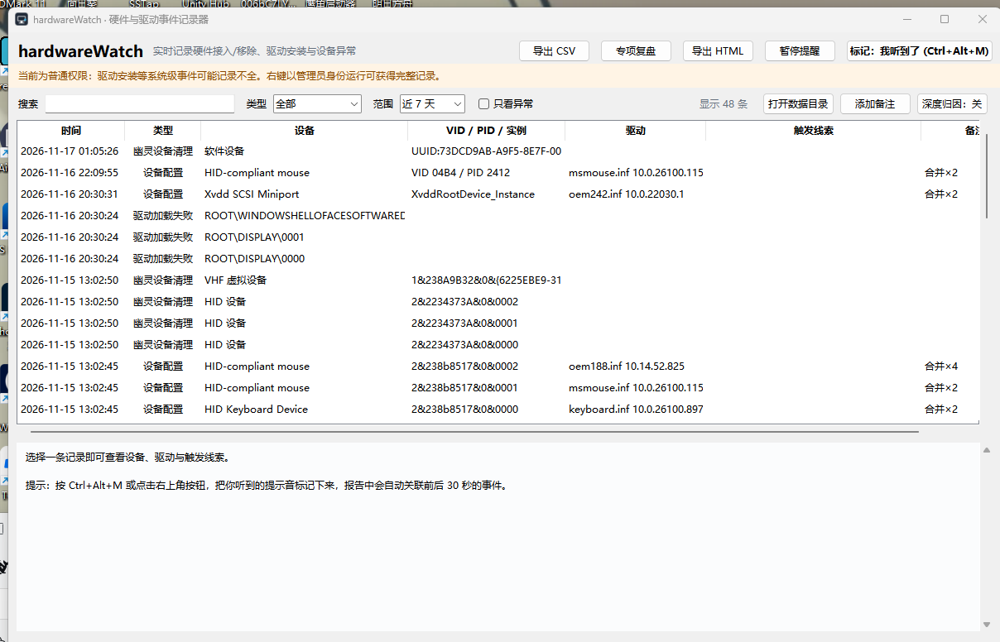

# hardwareWatch

> Windows 硬件与驱动事件记录器：把只“叮咚”一声、却不告诉你是啥的系统事件，
> 变成带设备名、VID/PID、驱动、时间和触发线索的可查时间线。

[English README](README_EN.md)

## 0. 下载 / Download

- **免安装版（Windows 10/11 x64，无需 Python）**：到
  [Releases](https://github.com/mafuyuyu/hardwareWatch/releases/latest) 下载
  <code>hardwareWatch-v0.1.0-windows-x64.zip</code>，解压后双击 <code>hardwareWatch.exe</code>。
- **源码运行**：克隆仓库后双击 <code>start_hardwarewatch.bat</code>（需 Python 3.8+）。

---

## 1. 它解决什么问题

Windows 在设备接入、移除、驱动安装时只播放系统提示音，不弹文字。于是你会遇到：

- 一天响很多次，不知道插了什么、拔了什么；
- 怀疑 USB 接触不良、Hub 供电不足，但没有证据；
- 驱动被 Windows Update 静默升级，设备异常却找不到时间点。

hardwareWatch 常驻托盘，持续记录并写入本地数据库：

| 事件 | 来源 | 说明 |
|---|---|---|
| 硬件接入 / 移除 | 设备树快照 diff + 卷广播 | 设备名、类别、VID/PID、父设备 |
| 设备配置 / 启动 | 内核 PnP 事件日志 | 驱动名、版本、驱动包 |
| 驱动安装 / 服务注册 / 卸载 | UserPnp 事件日志 | DeviceInstanceID、服务名、sys 文件 |
| 设备异常 | PnP 错误事件 | Problem 代码、失败驱动 |
| 幽灵设备清理 | PnP 420 / 0x2D | 虚拟 HID 移除记录（非故障） |
| 驱动加载失败 | System 219 | 失败驱动名与 NTSTATUS |
| Windows 更新 | WindowsUpdateClient | 与时间线交叉比对 |
| 睡眠 / 唤醒 | Kernel-Power 42/107 | 唤醒后 USB 重新枚举的上下文 |
| 声音标记 | 你按 Ctrl+Alt+M | 关联前后 30 秒事件 |
| 深度归因（可选） | 进程创建审计 4688 | 定位触发驱动安装的进程与命令行 |
| 专项复盘 | 一键 HTML | Xvdd / WUDFRd / 显示音频变化 / 软件画像 / 实验建议 |

> **关于归因**：Windows 不公开“驱动安装由哪个进程发起”。默认模式给出安装方式、
> 时间窗内新启动的进程与相关软件；开启深度归因后可捕获进程命令行，并标注置信度。

---

## 2. 快速开始

1. 安装 Python 3.8+，安装时勾选 **Add Python to PATH**（本机为 3.8.10）。
2. 双击 <code>start_hardwarewatch.bat</code>（普通权限，可记录大部分插拔）。
3. 需要驱动安装、登录前事件：双击 <code>start_hardwarewatch_admin.bat</code>，在 UAC 点“是”。
4. 听到提示音时按 **Ctrl+Alt+M**，或点窗口右上角「标记：我听到了」。
5. 点「导出 HTML」生成单文件报告；点「专项复盘」生成深度分析报告。
6. 管理员模式下可点「深度归因：关」开启进程审计（见第 7 节）。

关闭窗口 = 隐藏到托盘，仍在记录；退出请用托盘右键菜单的「退出」。

### 开机自启（可选）

- 双击 <code>install_autostart.bat</code> → 同意 UAC，创建登录时以最高权限启动的计划任务。
- 取消：双击 <code>uninstall_autostart.bat</code>。

### 便携模式

在程序目录新建空文件 <code>portable.txt</code>，数据写到 <code>data/</code> 子目录，可整目录拷走。
默认数据目录：<code>%LOCALAPPDATA%\hardwareWatch\ </code>
（数据库、日志、导出文件；首次运行会自动从旧的 <code>HwWatch</code> 目录迁移）。

---

## 3. 界面说明

- 顶部：导出 CSV / 专项复盘 / 导出 HTML / 暂停提醒 / 标记按钮。
- 筛选：关键字（设备名/实例 ID/驱动/备注）、类型、时间范围、只看异常。
- 列表：时间、类型、设备、VID/PID、驱动、触发线索、备注；红=严重，橙=警告，绿=声音标记。
- 底部：选中行的完整详情（含原始事件 JSON），可添加备注。
- 托盘菜单：显示主窗口 / 标记 / 暂停提醒 / 打开数据目录 / 导出 HTML / 专项复盘 / 退出。

状态栏会显示：运行状态、今日/累计条数、最近事件时间、权限、深度归因开关。

---

## 4. 怎么用它找出“到底是谁在响”

1. **先看「疑似反复重连」**：导出 HTML 报告后，顶部“重点结论”列出 15 分钟内
   接入/移除次数最多的设备。同一设备频繁出现 → 优先查线材、接口、Hub 供电、无线接收器干扰。
2. **对照声音标记**：标记前后 30 秒的事件会列在详情里。若标记附近没有任何硬件事件，
   说明声音不是设备接入，而是某个软件自行播放了 <code>Windows Hardware Insert.wav</code>。
3. **看驱动变更**：驱动被静默升级后设备常会重新枚举，表现为一次接入 + 一次配置。
4. **看异常设备**：Problem 代码（如 0x2D 幽灵设备、0x0A 无法启动）会出现在异常行里。

### 如果仍然“有声音、无记录”

说明该声音不是由设备树变更触发的，可能是：

- 某个程序调用系统提示音（设置 → 系统 → 声音 → 更多声音设置 → 程序事件里把
  “设备连接/断开”设为“无”，若声音消失即可确认）；
- 音频设备切换（默认播放设备变化）不一定产生 PnP 事件；
- 程序自身播放的音效。

此时“记录为空”本身就是证据：不是硬件插拔。

---

## 5. 工作原理

- **设备树快照 diff**：每 3 秒 + WM_DEVICECHANGE 即时触发，枚举present设备并比对，
  得到接入、移除、驱动变更；注册表解析设备名、类别、VID/PID、父设备与 Problem 状态。
- **事件日志**：通过 wevtapi 读取 Kernel-PnP/Configuration、System、WindowsUpdateClient，
  按 EventRecordID 去重，支持 7 天回填。
- **卷广播**：WM_DEVICECHANGE 的 DBT_DEVICEARRIVAL/REMOVECOMPLETE 提供盘符级即时事件。
- **合并去重**：同一设备 3 秒内的多条系统事件合并为一条（列表显示“合并×N”）。
- **反复重连告警**：15 分钟内同一设备 ≥6 次变化会生成告警并弹通知。
- **存储**：SQLite（WAL）；CSV/HTML 导出；数据不联网。

---

## 6. 专项复盘报告

窗口顶部「专项复盘」或托盘菜单生成单文件 HTML，包含：

- 结论排序：Xvdd 是否只在开机配置、WUDFRd 失败是否启动噪音、0x2D 幽灵设备是否运行期出现、
  显示器/音频端点变化、异常设备、串流软件画像；
- 证据表：Xvdd 事件与“距开机秒数”、显示/音频端点变化时间线、开机时间；
- 软件画像：含 xvdd 的 INF、相关服务、已安装的串流/远程软件、当前运行的相关进程；
- 时间重合的计划任务（标注“相关/例行任务”，避免误判）；
- 按性价比排序的验证实验，每步都能证伪一个假设。

命令行方式：<code>python analyze_hardware.py [天数]</code>。

---

## 7. 深度归因（可选，需管理员）

Windows 只记录“哪个设备被安装”，不记录“谁发起的安装”。开启后：

1. 临时启用 **进程创建审计**（Process Creation，成功事件）并打开命令行记录；
2. 实时读取 Security 日志 4688；
3. 把设备事件前后 20 秒内启动的进程与设备实例做匹配；
4. 结果显示在“触发线索”中，并标注 high / medium / low。

安全设计：

- 开启前 <code>auditpol /backup</code> 备份完整审计策略；
- **只改审计策略，不改任何文件/注册表 ACL**；
- 退出程序自动 <code>auditpol /restore</code> 并恢复命令行开关；
- 备份在数据目录 <code>auditpol_backup.csv</code>；若异常退出，重新启动再关闭即可恢复，
  或手动执行 <code>auditpol /restore /file:&lt;数据目录&gt;\auditpol_backup.csv</code>。

注意：命令行参数可能含敏感信息，只存本机；4688 只捕获新进程，长期驻留程序后续调用
SetupAPI 不会被记录。

---

## 8. 权限与数据

- 普通权限：可读 PnP 配置、System 事件，覆盖多数插拔。
- 管理员：登录前事件、部分驱动安装通道、深度归因。
- 数据只在本机：SQLite + 轮转日志；默认永久保留（<code>settings.json</code> 的
  <code>retention_days</code> 预留了 7/30 天配置）。
- 不上传、不联网、不需要账号。

---

## 9. 目录结构

<pre>
run.pyw                    启动入口（pythonw）
start_hardwarewatch.bat    普通权限启动
start_hardwarewatch_admin.bat  管理员启动（UAC）
install_autostart.bat      安装开机自启（计划任务，最高权限）
uninstall_autostart.bat    移除开机自启
elevate_run.py             UAC 提权启动辅助
analyze_hardware.py        专项复盘命令行入口
hardwarewatch/
  winapi.py                Win32 封装：隐藏窗口、托盘、热键、进程快照
  pnp.py                   SetupAPI 设备枚举、注册表描述、快照 diff
  evtlog.py                wevtapi 事件日志读取（XPath、XML）
  classify.py              事件归一化与中文标签
  attrib.py                setupapi.dev.log 跟踪、进程窗口、软件线索
  deepaudit.py             进程创建审计（4688）与归因
  forensics.py             专项复盘分析与 HTML 报告
  store.py                 SQLite 存储、去重/合并、查询
  exporter.py              CSV / 单文件 HTML 报告
  app.py                   采集线程、通知、反复重连告警
  ui.py                    Tkinter 主窗口
  main.py                  单实例、日志、启动
assets/hw.ico              托盘/窗口图标
docs/screenshot.png        界面截图
</pre>

运行日志：<code>%LOCALAPPDATA%\hardwareWatch\logs\hardwarewatch.log</code>。

---

## 10. 已知限制

- 设备树默认 3 秒轮询 + 设备变更消息即时触发，极端瞬时插拔（&lt;0.3 秒）可能合并为一次。
- 同一设备 3 秒内的多条系统事件会合并（显示“合并×N”）。
- 驱动安装的“发起进程”默认只能给线索；深度归因也只捕获进程启动事件。
- 首次启动回填最近 7 天事件（<code>settings.json</code> 的 <code>backfill_days</code>）。
- 界面为中文；高 DPI 已适配。

---

## 11. 常见问题

**Q：为什么插 U 盘会出现两条（驱动器 E: + 设备）？**

A：一条来自卷广播（立刻、含盘符），一条来自设备树 diff（含 VID/PID、父 Hub），互补。

**Q：能删除记录吗？**

A：关闭程序后删除数据目录里的 <code>hardwarewatch.db</code>。

**Q：会拖慢电脑吗？**

A：常驻约 30–50 MB，CPU 基本为 0；每 2 秒读事件日志、每 3 秒枚举设备树（约 30 ms）。

**Q：安全软件会报毒吗？**

A：不联网、不改系统文件；含全局热键、托盘、计划任务，个别安全软件可能提示，选择允许即可。

---

## 12. 开发与许可

- Python 3.8+，仅标准库 + ctypes，无第三方依赖。
- 提 Issue / PR 均可；改动后运行 <code>python -m compileall -q hardwarewatch</code> 做语法检查。
- MIT License，见 [LICENSE](LICENSE)。
