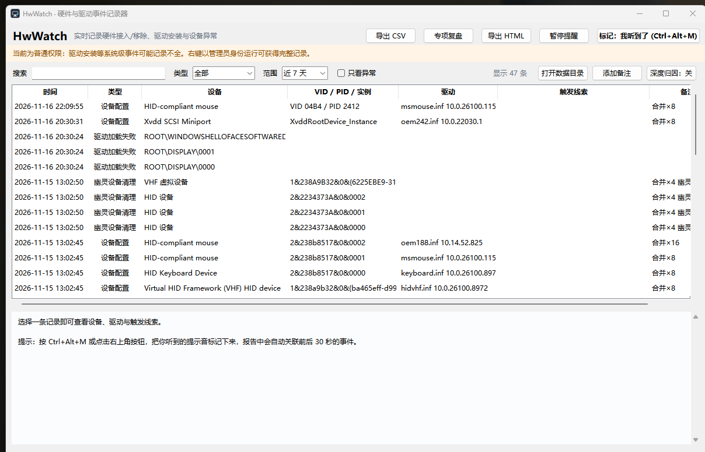

# HwWatch · Windows 硬件与驱动事件记录器

常驻托盘的小工具：把 Windows 只“叮咚”一声、却不告诉你是什么的硬件事件，
变成带设备名、VID/PID、驱动、时间和触发线索的可查记录。

适配 Windows 10/11，纯 Python 标准库 + ctypes，无需安装第三方包。

---

## 1. 它解决什么问题

Windows 在设备接入、移除、驱动安装时只播放系统提示音，不弹文字。于是你会遇到：

- 一天响很多次，不知道插了什么、拔了什么；
- 怀疑 USB 接触不良、Hub 供电不足，但没有证据；
- 驱动被 Windows Update 静默升级，设备异常却找不到时间点。

HwWatch 持续监听并写入本地数据库：

| 事件 | 来源 | 说明 |
|---|---|---|
| 硬件接入 / 移除 | 设备树快照 diff + 卷广播 | 含设备名、类别、VID/PID、父设备 |
| 设备配置 / 启动 | 内核 PnP 事件日志 | 含驱动名、版本、驱动包 |
| 驱动安装 / 服务注册 | UserPnp 事件日志 | 含 DeviceInstanceID、服务名、sys 文件 |
| 设备异常 | PnP 错误事件 | 含 Problem 代码、失败驱动 |
| 驱动加载失败 | System 219 | 含失败驱动名与 NTSTATUS |
| Windows 更新 | WindowsUpdateClient | 用于和时间线交叉比对 |
| 声音标记 | 你按 Ctrl+Alt+M | 关联前后 30 秒事件 |
| 深度归因（可选） | Windows 进程创建审计 4688 | 定位触发驱动安装的进程与命令行，需管理员 |
| 专项复盘 | 一键 HTML | Xvdd / WUDFRd / 显示音频变化 / 软件画像 / 实验建议 |

> 重点：**Windows 不公开“驱动安装是由哪个进程发起的”**。HwWatch 会给出
> 安装方式（硬件触发/更新驱动）、时间窗内新启动的进程、相关厂商软件，
> 并标注置信度（high / medium / low），而不是假装精确。

---

## 2. 快速开始

1. 确认已安装 Python 3.8+（本机已装 3.8.10），安装时勾选 **Add Python to PATH**。
2. 双击 <code>start_hwwatch.bat</code>（普通权限，能记录大部分插拔）。
3. 想记录驱动安装、登录前事件：双击 <code>start_hwwatch_admin.bat</code>，在 UAC 弹窗点“是”。
4. 程序出现在托盘。听到提示音时按 **Ctrl+Alt+M**，或点窗口右上角
   「标记：我听到了」。之后打开窗口，标记行会关联附近事件。
5. 需要给懂电脑的人看：点「导出 HTML」，生成带结论、可疑设备、完整时间线的单文件报告。
6. 管理员模式下还可：点「深度归因：关」开始记录进程创建（定位是谁装的驱动）；
   点「专项复盘」一键生成针对虚拟显示器/驱动加载失败的分析报告。

关闭窗口 = 隐藏到托盘，仍在记录；退出请用托盘右键菜单的「退出」。

### 开机自启（可选）

- 双击 <code>install_autostart.bat</code> → 同意 UAC。会创建登录时以最高权限启动的计划任务。
- 取消：双击 <code>uninstall_autostart.bat</code>。

### 便携模式

在程序目录新建空文件 <code>portable.txt</code>，数据就写到 <code>data\</code> 子目录，
可整个文件夹拷走。默认数据目录：<code>%LOCALAPPDATA%\HwWatch\</code>
（数据库、日志、导出文件）。

---

## 3. 界面说明

- 顶部：标记按钮、暂停/恢复**提醒**（记录不中断）、导出 CSV / HTML。
- 筛选：关键字（设备名/实例 ID/驱动/备注）、类型、时间范围、只看异常。
- 列表：时间、类型、设备、VID/PID、驱动、触发线索、备注。
  - 红色 = 严重（驱动加载失败、设备异常）
  - 橙色 = 警告（设备异常、疑似反复重连）
  - 绿色 = 你的声音标记
- 底部：选中行的完整详情（含原始事件 JSON），可直接“添加备注”。

托盘菜单：显示主窗口 / 标记 / 暂停提醒 / 打开数据目录 / 导出 HTML / 退出。

---

## 4. 怎么用它找出“到底是谁在响”

1. **先看「疑似反复重连」**：导出 HTML 报告后，顶部“重点结论”和
   “疑似反复重连的设备”会列出 15 分钟内接入/移除次数最多的设备。
   - 同一设备频繁出现 → 优先怀疑线材、接口、USB Hub 供电、无线接收器干扰。
2. **对照声音标记**：如果你按了 Ctrl+Alt+M，标记前后 30 秒的事件会列在详情里；
   如果标记附近**没有任何硬件事件**，说明声音不是设备接入，而是某个软件
   自行播放了 <code>Windows Hardware Insert.wav</code>（例如外设灯控、手机助手、串流软件）。
   此时“触发线索”里的相关软件列表就有意义。
3. **看驱动变更**：驱动被静默升级后设备常会重新枚举，表现为一次接入 + 一次配置。
4. **看异常设备**：黄色感叹号、Problem 代码（如 0x2D）会出现在异常行里。

### 如果仍然“有声音、无记录”

说明该声音不是由设备树变更触发的，可能是：

- 某个程序调用系统提示音（可在“设置 → 系统 → 声音 → 更多声音设置 → 程序事件”
  里把“设备连接/断开”设为“无”，观察是否消失——这是最快的排除法）；
- 音频设备切换（默认播放设备变化）不一定产生 PnP 事件；
- 程序自身播放的音效。

HwWatch 的价值在于：**当它记录为空时，本身就是一个强证据**——说明不是硬件插拔。

---

## 5. 权限与数据

- 普通权限：可读 PnP 配置、System 事件，能捕获绝大多数插拔；窗口顶部会提示。
- 管理员：额外覆盖登录前事件、部分驱动安装通道，推荐长期使用。
- 数据只在本机：SQLite 数据库 + 轮转日志。
- 默认永久保留（<code>settings.json</code> 的 <code>retention_days</code> 预留了 7/30 天配置）。
- 不上传、不联网、不需要账号。

---

## 6. 文件结构

<pre>
run.pyw                  启动入口（pythonw）
start_hwwatch.bat        普通权限启动
start_hwwatch_admin.bat  管理员启动（UAC）
install_autostart.bat    安装开机自启（计划任务，最高权限）
uninstall_autostart.bat  移除开机自启
elevate_run.py           UAC 提权启动辅助
hwwatch/
  winapi.py              Win32 封装：隐藏窗口、托盘、热键、进程快照
  pnp.py                 SetupAPI 设备枚举、注册表描述、快照 diff
  evtlog.py              wevtapi 事件日志读取（XPath、XML）
  classify.py            事件归一化与中文标签
  attrib.py              setupapi.dev.log 跟踪、进程窗口、软件线索
  store.py               SQLite 存储、去重/合并、查询
  exporter.py            CSV / 单文件 HTML 报告
  app.py                 采集线程、通知、反复重连告警
  ui.py                  Tkinter 主窗口
  main.py                单实例、日志、启动
assets/hw.ico            托盘/窗口图标
</pre>

运行日志：<code>%LOCALAPPDATA%\HwWatch\logs\hwwatch.log</code>
（排查启动失败时先看它。）

---

## 7. 已知限制

- 设备树快照默认 3 秒轮询 + 设备变更消息即时触发，极端瞬时插拔（<0.3 秒）
  可能被合并为一次事件。
- 同一设备 3 秒内的多条系统事件会合并（列表里显示 xN），避免刷屏。
- 驱动安装的“发起进程”只能给线索，不能给定论（Windows 限制）。
- 首次启动会回填最近 7 天事件（<code>settings.json</code> 的 <code>backfill_days</code>）。
- 界面为中文；高 DPI 已做适配。

---

## 8. 常见问题

**Q：为什么每次插 U 盘会同时出现两条（驱动器 E: + 设备）？**

A：一条来自卷广播（立刻、含盘符），一条来自设备树 diff（含 VID/PID、父 Hub）。
两者互补，排查时看“设备”那条。

**Q：能删除记录吗？**

A：可以关闭程序后删除数据目录里的 <code>hwwatch.db</code>；或告诉我，我加一个“清空”按钮。

**Q：会拖慢电脑吗？**

A：常驻内存约 30–50 MB，CPU 基本为 0；每 2 秒读一次事件日志、每 3 秒枚举一次
设备树（约 30 ms）。

**Q：安全软件会报毒吗？**

A：程序不联网、不改系统文件；但含全局热键、托盘、计划任务，个别安全软件
可能提示，选择“允许”即可。

---

## 9. 深度归因（可选，需管理员）

Windows 只记录“哪个设备被安装”，不记录“谁发起的安装”。开启深度归因后：

1. 临时启用 Windows 的**进程创建审计**（Process Creation，成功事件），
   并打开命令行记录（<code>ProcessCreationIncludeCmdLine_Enabled</code>）；
2. 实时读取 Security 日志的 4688 事件；
3. 把设备事件前后 20 秒内启动的进程、命令行与设备实例做匹配
   （命中 <code>pnputil</code>、<code>devcon</code>、<code>.inf</code>、
   设备实例 ID 等会提高置信度）；
4. 结果显示在该事件的“触发线索”中，并标注 high / medium / low。

安全设计：

- 开启前用 <code>auditpol /backup</code> 备份完整审计策略；
- **只改审计策略，不改任何文件/注册表 ACL**；
- 退出程序时自动 <code>auditpol /restore</code> 并恢复命令行记录开关；
- 备份文件在数据目录 <code>auditpol_backup.csv</code>。若程序异常退出，
  重新启动后再关闭即可恢复，或手动执行
  <code>auditpol /restore /file:&lt;数据目录&gt;auditpol_backup.csv</code>。

注意：命令行参数可能包含敏感信息（路径、用户名），日志只存在本机；
审计只捕获“新进程”，长期驻留程序后来调用 SetupAPI 不会被 4688 记录。

---

## 10. 专项复盘报告

窗口顶部「专项复盘」或托盘菜单「生成专项复盘报告」会生成一份单文件 HTML，包含：

- **结论排序**：Xvdd 是否只在开机时配置、WUDFRd 失败是否启动噪音、
  0x2D 幽灵设备是否运行期出现、显示/音频端点变化、异常设备、串流软件画像；
- **证据表**：Xvdd 事件与“距开机秒数”、显示/音频端点变化时间线、开机时间；
- **软件画像**：包含 xvdd 的 INF（Provider/版本）、相关服务、已安装的
  串流/远程软件、当前运行的相关进程；
- **时间重合的计划任务**（标注“相关/例行任务”，避免误判）；
- **可执行的验证实验**：按性价比排序，每步都能证伪一个假设。
