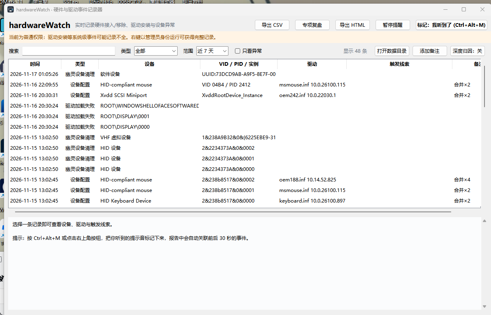

# hardwareWatch

> A Windows tray recorder for hardware and driver events: turns the wordless
> "ding-dong" into a searchable timeline with device name, VID/PID, driver,
> timestamp and best-effort attribution.

[中文说明](README.md)

## 0. Download

- **Portable build (Windows 10/11 x64, no Python needed)**: grab
  <code>hardwareWatch-v0.1.0-windows-x64.zip</code> from
  [Releases](https://github.com/mafuyuyu/hardwareWatch/releases/latest) and run
  <code>hardwareWatch.exe</code>.
- **From source**: clone the repo and run <code>start_hardwarewatch.bat</code>
  (Python 3.8+).

---

## 1. Why

Windows plays the device-connect / device-remove sound but never says which
device, which driver, or which process caused it. hardwareWatch stays in the
tray and journals:

| Event | Source | Details |
|---|---|---|
| Device arrival / removal | device-tree diff + volume broadcast | name, class, VID/PID, parent |
| Device configured / started | Kernel-PnP event log | driver name/version/package |
| Driver install / service / uninstall | UserPnp event log | instance ID, service, .sys |
| Device problems | PnP error events | problem code, failing driver |
| Phantom cleanup | PnP 420 / 0x2D | virtual HID removed (not a fault) |
| Driver load failures | System 219 | failing driver + NTSTATUS |
| Windows Update | WindowsUpdateClient | cross-reference |
| Sleep / wake | Kernel-Power 42/107 | context for USB re-enumeration |
| Sound marker | press Ctrl+Alt+M | correlates events within ±30 s |
| Deep attribution (opt-in) | process-creation audit 4688 | process + command line |
| Forensic review | one-click HTML | Xvdd / WUDFRd / display-audio churn / experiments |

## 2. Quick start

1. Install Python 3.8+ with **Add Python to PATH**.
2. Double-click <code>start_hardwarewatch.bat</code> (normal rights).
3. For driver installs / pre-logon events: <code>start_hardwarewatch_admin.bat</code> (UAC).
4. Press **Ctrl+Alt+M** whenever you hear the beep, or click the marker button.
5. Use “Export HTML” for a report, “Forensic review” for the deep analysis.

Closing the window hides it to the tray; use the tray menu to exit.

Optional auto-start: run <code>install_autostart.bat</code> (creates a logon
scheduled task with highest privileges); remove with <code>uninstall_autostart.bat</code>.

Portable mode: create an empty <code>portable.txt</code> next to the scripts and
data goes to <code>data/</code>. Default data directory:
<code>%LOCALAPPDATA%\hardwareWatch\ </code> (migrates from the old HwWatch folder on first run).

## 3. Finding the culprit

1. Check “rapid reconnect” devices in the HTML report: a device flipping
   arrival/removal many times within 15 minutes usually means a bad cable, a
   weak USB hub, or a wireless receiver losing link.
2. Compare your sound markers: if nothing is logged around a marker, the sound
   was played by software, not a real device change (set the Windows
   “Device Connect/Disconnect” sounds to None to confirm).
3. Look at driver changes: a silent driver update often re-enumerates the device.
4. Check problem devices (0x2D is phantom cleanup, not a fault).

## 4. How it works

- Device-tree snapshots every 3 s plus WM_DEVICECHANGE; registry lookup for
  friendly name, class, VID/PID, parent and problem status.
- wevtapi reads Kernel-PnP/Configuration, System, WindowsUpdateClient; dedupe by
  EventRecordID; 7-day backfill.
- Volume broadcasts add drive-letter-level events immediately.
- Events from the same device within 3 s are coalesced (shown as “merged ×N”).
- SQLite (WAL) storage; CSV and self-contained HTML reports; no network access.

## 5. Deep attribution (opt-in, admin)

1. Enables the Windows **Process Creation** audit subcategory and command-line
   logging.
2. Reads Security 4688 events in real time.
3. Correlates processes started within ±20 s of a device event; command lines
   mentioning pnputil/devcon/.inf/instance IDs raise confidence.

Safety: <code>auditpol /backup</code> before enabling, only audit policy is
changed (no ACLs), and <code>auditpol /restore</code> runs on exit. The backup
lives in the data directory as <code>auditpol_backup.csv</code>.

## 6. Forensic review

Generates a single-file HTML with ranked hypotheses, boot-time correlation,
display/audio endpoint churn, device/driver inventory, installed streaming and
remote-desktop software, matching scheduled tasks, and a falsifiable experiment
plan. CLI: <code>python analyze_hardware.py [days]</code>.

## 7. Data & privacy

Local only: SQLite database, rotating log, exports. No telemetry, no upload, no
account. Normal user can record most plug/unplug events; admin adds pre-logon
events, some driver-install channels and deep attribution.

## 8. Layout

<pre>
run.pyw
start_hardwarewatch.bat / start_hardwarewatch_admin.bat
install_autostart.bat / uninstall_autostart.bat
elevate_run.py
analyze_hardware.py
hardwarewatch/   (winapi, pnp, evtlog, classify, attrib, deepaudit,
                  forensics, store, exporter, app, ui, main)
assets/hw.ico
docs/screenshot.png
</pre>

Log: <code>%LOCALAPPDATA%\hardwareWatch\logs\hardwarewatch.log</code>.

## 9. Limitations

- 3 s polling plus instant device-change messages; extremely short (<0.3 s)
  plug/unplug cycles may be coalesced.
- Driver-install initiator is best-effort; 4688 only records new processes.
- First run backfills 7 days of event-log history.

## 10. License

MIT — see [LICENSE](LICENSE).
